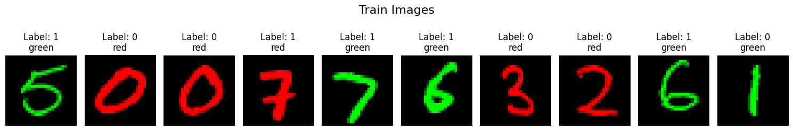
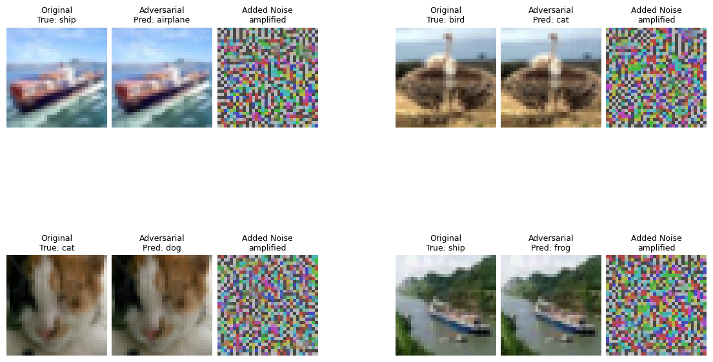

# CA1 · Robustness and adversarial attacks

[← All projects](../README.md) · [Report](CA1_report.pdf) · [Assignment specification](TAI_CA1_Description.pdf)

## Q1 — Learning with spurious correlations

[Open the notebook](Q1/CA1_Q1.ipynb)

**Question:** Can a model learn digit structure when color provides an easier shortcut during training?

MNIST digits are grouped into two classes: 0–4 and 5–9. Training images have a 95% color–label correlation, while the test set reverses that association. This creates a distribution shift that exposes reliance on the spurious color feature.

The experiment proceeds through:

1. Loading and coloring the 60,000 training and 10,000 test images.
2. Training a small multilayer perceptron with empirical risk minimization (ERM).
3. Extracting the 2,242 misclassified training examples and upsampling them for JTT-style retraining.
4. Comparing the retrained model with ERM and generalized cross entropy (GCE), including an error-set breakdown by label and color.

### Saved results

| Training method | Accuracy on the original training set | Accuracy on the shifted test set |
| --- | ---: | ---: |
| ERM | 96.30% | 28.65% |
| JTT-style retraining | 97.38% | 90.90% |
| GCE | 95.55% | 9.31% |

JTT-style retraining substantially improves shifted test accuracy in this run. ERM and GCE still achieve high training accuracy despite poor performance after the color correlation changes.

*Training examples show the color shortcut: class 0 is usually red, and class 1 is usually green. The test set reverses this association.*

## Q2 — Adversarial attacks on CIFAR-10

[Open the notebook](Q2/CA1_Q2.ipynb)

**Question:** How much can small, gradient-based perturbations change a pretrained image classifier's predictions?

The notebook evaluates a pretrained ResNet-20 on 25 correctly classified CIFAR-10 samples. It implements a single-step fast gradient sign method (FGSM) and iterative projected gradient descent (PGD), then visualizes original images, attacked images, and perturbations.

### Saved results

| Evaluation | Settings in the notebook | Accuracy | Misclassified images |
| --- | --- | ---: | ---: |
| Clean samples | No attack | 100.00% | 0 / 25 |
| FGSM | ε = 0.03 | 28.00% | 18 / 25 |
| PGD | ε = 0.03, α = 0.005, 20 steps | 4.00% | 24 / 25 |

Perturbations are applied to normalized inputs; the ε values above use those input units. These results describe the selected 25-image subset rather than the full CIFAR-10 test set.

*PGD changes predictions while leaving the attacked images visually similar to the originals. The noise panels are amplified for visibility.*

## Running the notebooks

- Run Q1 from `CA1/Q1/`. The four compressed MNIST files are included under `Dataset/Mnist/`; reference papers are in `Articles/`.
- Run Q2 from `CA1/Q2/`. The checkpoint, 25 sample images, and local `pytorch-cifar-models` implementation are included. The notebook adds that implementation to its import path.
- Q2's `DEVICE` defaults to `"cpu"`. Adapt its selection cell if using CUDA or Apple MPS.

The figures and numbers above come from the notebooks' saved outputs; they were not regenerated during the documentation update.

See the root [installation instructions](../README.md#getting-started) and [input inventory](../docs/DATASETS.md).
