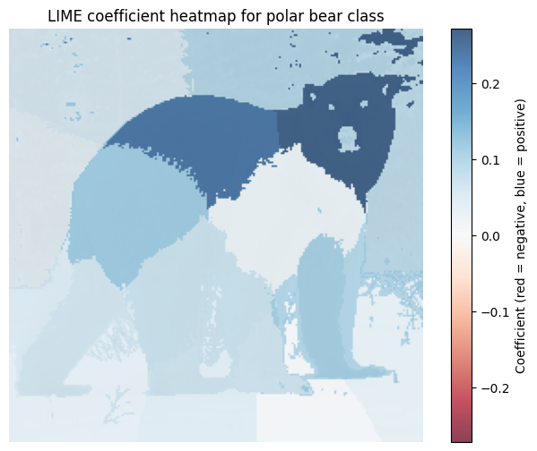
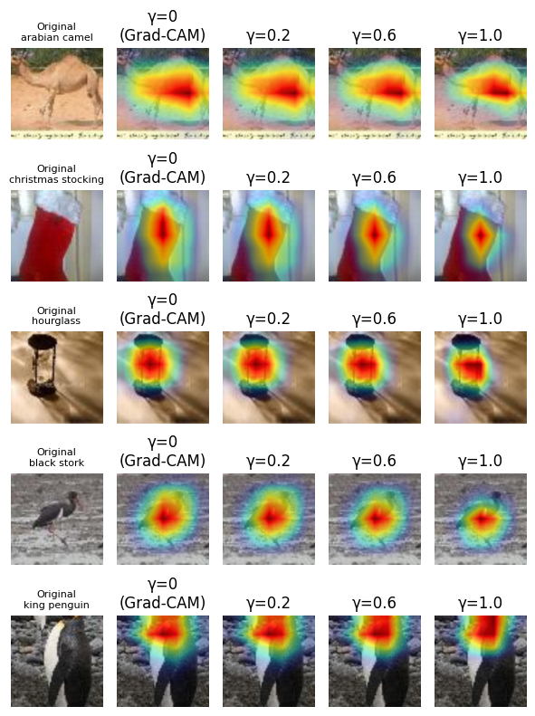

# CA2 · Visual interpretability

[← All projects](../README.md) · [Report](CA2_report.pdf) · [Assignment specification](TAI_CA2_Description.pdf)

## Q1 — LIME from scratch

[Open the notebook](Q1/q1.ipynb)

**Question:** Which image regions support a particular prediction, according to a local approximation of the classifier?

The notebook builds a LIME-style explanation pipeline around an ImageNet-pretrained ResNet-18:

1. Resize each image to 224 × 224 and segment it into 18 regions using a NumPy k-means implementation with color and spatial features.
2. Generate 1,000 binary masks and replace hidden regions with the image's mean color.
3. Query the classifier for the target-class probabilities of the perturbed images.
4. Weight masks by proximity to the unperturbed image and fit a sparse Lasso surrogate.
5. Map the surrogate coefficients back onto the image to show each region's local contribution.

### Saved examples

| Example | Target ImageNet class index | Original target-class probability |
| --- | ---: | ---: |
| Cat | 282 | 90.55% |
| Polar bear | 296 | 99.64% |

*Blue regions have positive surrogate coefficients for the polar bear class; stronger blue indicates a larger contribution. Red would indicate a negative coefficient. These are local surrogate contributions, not probabilities or causal effects.*

## Q2 — Grad-CAM and its variants

[Open the notebook](Q2/q2.ipynb)

**Question:** How do gradient-based explanations change when we add fine detail or contrast the predicted class with competing classes?

The notebook loads Tiny ImageNet validation images and compares three approaches on correctly classified examples:

| Method | Implementation idea |
| --- | --- |
| Grad-CAM | Weight convolutional feature maps with gradients of the target score to produce a coarse localization map. |
| Guided Grad-CAM | Combine the class activation map with guided backpropagation for finer visual detail. |
| FinerGrad-CAM | Backpropagate the target logit minus γ times the mean logit of three competing classes. |

The FinerGrad-CAM comparison uses γ = 0, 0.2, 0.6, and 1.0. At γ = 0, its scoring objective reduces to the Grad-CAM baseline. The saved comparison includes an Arabian camel, Christmas stocking, hourglass, black stork, and king penguin.

*Each row keeps the image fixed while changing γ. The warmer regions show stronger activation in the displayed map. This is a qualitative comparison; the notebook does not establish an explanation-quality ranking from these images alone.*

## Running the notebooks

- Run Q1 from `CA2/Q1/` and Q2 from `CA2/Q2/`. Both load the included shared checkpoint at `../assets/resnet18-f37072fd.pth`.
- Q1 requires `cat.jpg` and `polarBear.png` in its folder. The original input files are absent; using other images changes the explanations. Update target class indices when changing image categories.
- Q2 requires `Q2/tiny-imagenet-200/`, preserving the dataset's `train/`, `val/`, `test/`, `wnids.txt`, and `words.txt` structure.

The figures and probabilities above are exported from saved notebook outputs, preserving the original examples without rerunning inference.

See the [data and model setup guide](../docs/DATASETS.md) for download links and the root [installation instructions](../README.md#getting-started) for Python dependencies.
