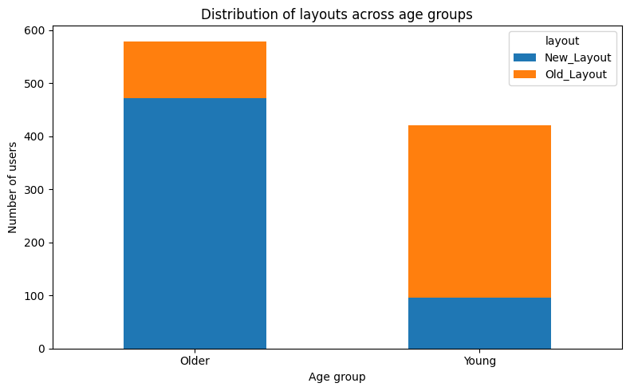
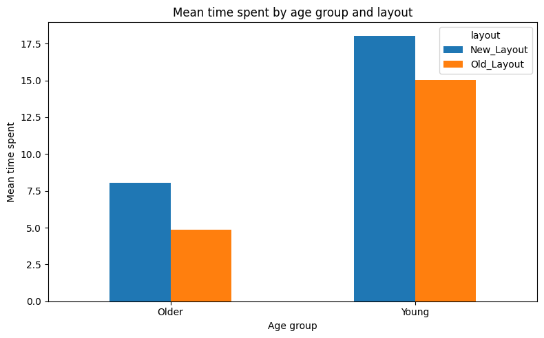

# CA3 · Causal reasoning

[← All projects](../README.md) · [Report](CA3_report.pdf) · [Assignment specification](TAI_CA3_Description.pdf)

[Open the notebook](CA3.ipynb)

**Question:** When does an observed association differ from the effect of an intervention?

The notebook moves from synthetic structural causal models to an analysis of website engagement. It uses NumPy and pandas for sampling and data, NetworkX for causal graphs, statsmodels for regression, and Matplotlib for visualizations.

## 1. Structural causal model implementation

The `SCM` class represents variables through their parents and structural equations. It builds and checks a directed acyclic graph, samples variables in topological order, and implements `do` interventions by fixing a variable's equation and removing its incoming edges. Graph plots make the assumed causal structure explicit.

## 2. Course-effect example

A latent variable affects both course participation and the outcome, so participants and nonparticipants differ before any intervention. The experiment contrasts an observational mean difference with samples generated under `do(X = 1)` and `do(X = 0)`.

| Estimate in the saved simulation | Value |
| --- | ---: |
| Observational outcome difference | 6.211 |
| Average treatment effect under intervention | 3.000 |

The observational comparison overstates the effect because it also reflects the common cause.

## 3. Simulated smoking example

The synthetic model connects age, socioeconomic status, genetics, smoking, and intermediate health variables. Shared exogenous draws allow comparisons under different smoking interventions. The notebook reports average treatment effect (ATE), effect among the treated (ATT), and conditional effects (CATE) by age.

| Simulated disease-probability difference | Percentage points |
| --- | ---: |
| ATE | 9.71 |
| ATT | 9.83 |
| CATE, age > 55 | 12.08 |
| CATE, age ≤ 55 | 8.69 |

These numbers describe the notebook's synthetic structural equations.

## 4. Website engagement and confounding

The included dataset contains 1,000 users with age group, layout, and time spent. A naive regression suggests that the new layout reduces engagement. Examining age reveals that older users disproportionately receive the new layout, while younger users spend more time on the site overall.

*Layout assignment is uneven across age groups: 471 older users receive the new layout, compared with 96 younger users.*

*Within both age groups, users with the new layout spend more time on average. The pooled comparison reverses this pattern because the groups have different baseline engagement and layout proportions.*

| Regression | Layout coefficient | p-value |
| --- | ---: | ---: |
| Naive, without age adjustment | −2.771 | 7.64 × 10⁻²³ |
| Adjusted for age group | +3.090 | 1.65 × 10⁻¹¹⁹ |
| Randomized placebo layout, adjusted for age | −0.043 | 0.729 |

The adjusted result is interpreted under the notebook's assumed causal graph. The placebo check yields a near-zero, statistically nonsignificant coefficient.

## Running the notebook

Run from `CA3/` with the root [Python dependencies](../README.md#getting-started) installed. `website_engagement_data.csv` is included beside the notebook. Execute the SCM implementation before the examples, which reuse its definitions.

All figures and estimates above come from the notebook's saved outputs; the documentation update did not rerun the simulations.
