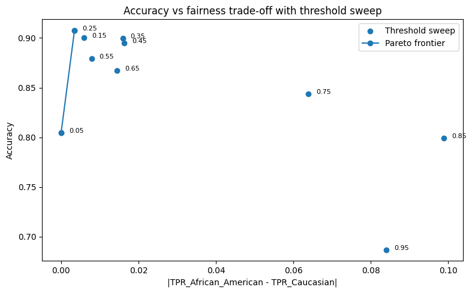
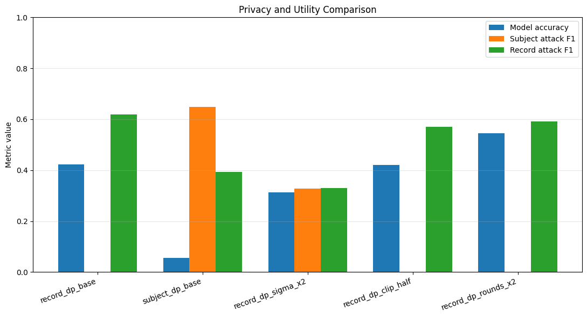

# CA4 · Fairness and privacy

[← All projects](../README.md) · [Report](CA4_report.pdf) · [Assignment specification](TAI_CA4_Description.pdf)

## Q1 — Fairness on COMPAS

[Open the notebook](Q1/Q1.ipynb)

**Question:** Does removing sensitive attributes eliminate disparities, and how do different fairness objectives affect model decisions?

The workflow applies the notebook's COMPAS filtering, leaving 6,172 records, then uses an 80/20 train–test split. A logistic regression pipeline handles imputation, scaling, and categorical encoding.

The analysis includes:

1. **Bias and proxy audit:** Compare outcome base rates and COMPAS score distributions, then predict race from other features. Removing names lowers the proxy model's ROC-AUC from 0.767 to 0.658 in the saved run.
2. **Baseline and unawareness:** Evaluate predictions by race and sex, then remove race and sex from the feature set and repeat the audit.
3. **Mitigation:** Compare training-data reweighing with group-specific threshold postprocessing for equal opportunity.
4. **Trade-offs and intersections:** Sweep thresholds, identify a Pareto frontier, compare selection-rate, true-positive-rate (TPR), false-positive-rate, and precision gaps, and audit race × sex groups.

### Saved fairness comparison

The gaps below are absolute differences between the African-American and Caucasian groups on the test set.

| Method | Selection-rate gap | TPR gap |
| --- | ---: | ---: |
| Baseline | 0.112 | 0.038 |
| Remove race and sex | 0.105 | 0.026 |
| Reweighing | 0.097 | 0.017 |
| Equal-opportunity postprocessing | 0.118 | 0.003 |

Removing sensitive features leaves measurable disparities. Equal-opportunity postprocessing sharply reduces the TPR gap in this run while increasing the selection-rate gap, illustrating that improvement depends on the chosen fairness objective.

*The threshold sweep plots accuracy against the TPR gap; labels indicate decision thresholds. The highlighted frontier contains the nondominated choices for these two objectives.*

## Q2 — Federated learning, membership inference, and differential privacy

[Open the notebook](Q2/Q2.ipynb)

**Question:** How do record-level and subject-level privacy defenses affect federated model utility and membership inference?

The experiment uses FEMNIST's 62 handwriting classes and writer identifiers. Writers are separated into member and nonmember groups, and member training records are partitioned across eight silos; a writer can appear in up to four silos.

- **Federated baseline:** Train a convolutional classifier with sample-weighted FedAvg aggregation. All eight silos participate in each round.
- **Membership inference:** Evaluate a loss-based record attack and a subject-level attack using loss behavior across rounds. Thresholds are chosen on validation samples and evaluated on held-out attack samples.
- **Privacy defenses:** Compare Opacus-based record-level DP-SGD with a subject-level gradient aggregation defense. The base experiments target ε = 4 and δ = 10⁻⁵, accounting for a subject's participation across silos.
- **Sensitivity experiments:** Double the record-level noise multiplier, halve the clipping norm, or double training rounds to inspect changes in utility and privacy accounting.

### Saved differential privacy results

| Experiment | Rounds | Reported ε | Model test accuracy |
| --- | ---: | ---: | ---: |
| Record-level DP, base | 20 | 3.991 | 42.28% |
| Subject-level DP, base | 20 | 3.997 | 5.48% |
| Record-level DP, doubled noise | 20 | 1.640 | 31.38% |
| Record-level DP, halved clipping norm | 20 | 3.991 | 42.11% |
| Record-level DP, doubled rounds | 40 | 5.776 | 54.55% |

Record-level ε is the maximum reported silo budget; subject-level ε is the notebook's worst-case composition across participating silos. The two defenses protect different units, so similar ε values do not make their guarantees interchangeable.

*The chart compares utility with attack F1 scores. Attack F1 depends on the selected threshold and class balance; the notebook also reports ROC-AUC and confusion matrices. A low attack F1 alone does not establish a privacy guarantee.*

## Running the notebooks

Run Q1 from `CA4/Q1/` after downloading `compas-scores-two-years.csv` from ProPublica. The [setup guide](../docs/DATASETS.md#ca4-q1--compas) includes the source and download command.

For Q2, install `requirements-federated.txt` using the root [environment instructions](../README.md#getting-started), then run from `CA4/Q2/`.

- The first data-loading cell downloads `flwrlabs/femnist` from Hugging Face. Internet access and space for its cache are required.
- Run data preparation, federated training, and membership inference before the differential privacy experiments. Those sections reuse partitions, checkpoints, and evaluation artifacts.
- The baseline trains for 10 rounds. A later continuation section adds another 10; rerunning that section can extend an existing run again.
- Training and the differential privacy comparisons can be expensive. GPU access helps, and reducing round counts changes the experiment settings and results.
- Generated `femnist_*` directories are ignored by Git. Keep any outputs you want to archive separately before cleaning them.

The figures and metrics above are taken from saved notebook outputs, without retraining. Consult the report for the full experimental comparisons.
